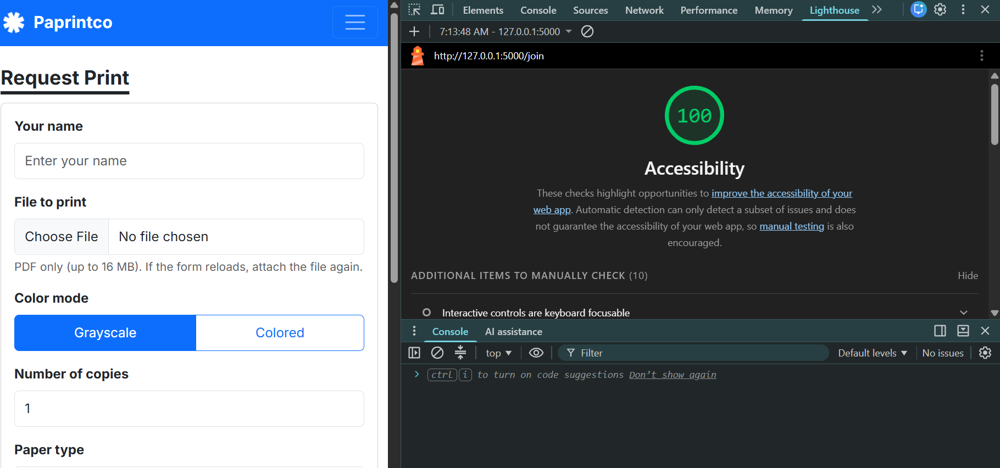
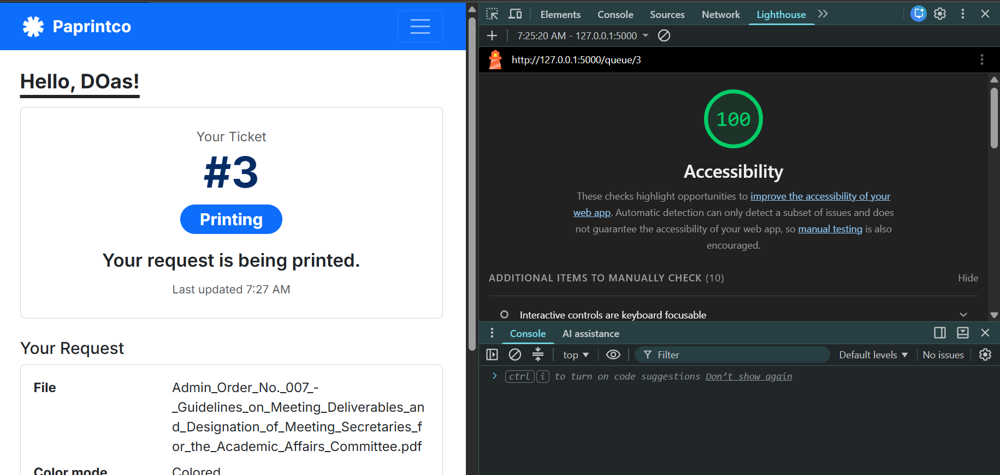
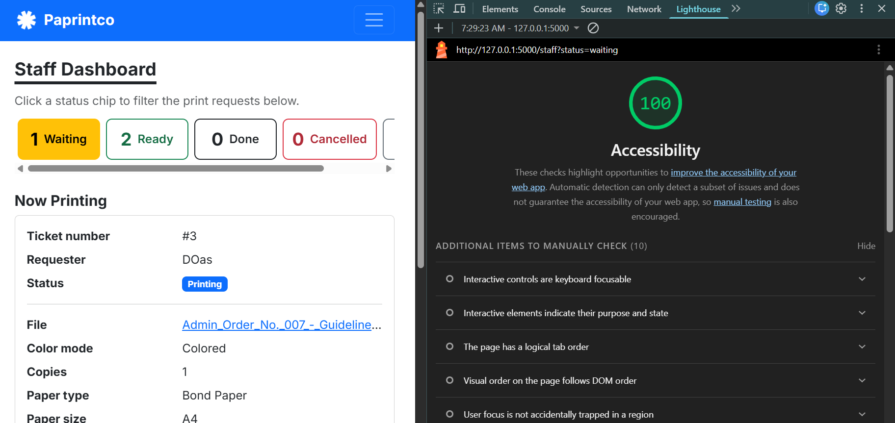

# Accessibility check

## 9a. Lighthouse

| Screen | Score before fixes | Score after fixes | Screenshot (final score) |
| --- | --- | --- | --- |
| Join | 100 | 100 |  |
| My place | 96 | 100 |  |
| Staff dashboard | 100 | 100 |  |

**Issue:** Lighthouse showed one issue on the "My place" screen: "Background and foreground colors do not have a sufficient contrast ratio." Low-contrast text is hard to read for many users, especially with tired eyes late in the day, which is one of my persona's accessibility needs.

- On "My place", the failing element was the large ticket number while the request is waiting. The yellow text (`text-warning`) on a white background has a contrast ratio of only 1.63, and large text needs at least 3.

**Fix for "My place":** I changed the waiting color for the ticket number from `text-warning` to Bootstrap's darker `text-warning-emphasis`. The status is still shown in words by the badge, so the color is only extra.

## 9b. Keyboard only

**Join the queue from the home page**
- "Can you see where the focus is at every step?" I could see where the focus was at every step.
- "Can you reach and use every control?" Yes, I could reach and use every control, including the file input, the color mode choice (arrow keys move between Grayscale and Colored), the paper dropdowns and the Submit request button.
- "Does the skip link appear on the first Tab?" Yes, the skip link appeared on the first Tab, at the top of the page.

**Staff dashboard**
- "Can you see where the focus is at every step?" Yes, I could see the focus at every step, except again on the menu bar links.
- "Can you reach and use every control?" Yes, I could filter by status with the keyboard (Tab to a status chip and press Enter), use Print next, use Mark as ready for pickup, and use Mark done. My app has one service (Print), so the filter is by status instead of by service.
- "Does the skip link appear on the first Tab?" Yes, the skip link also appeared on this screen.

## 9c. Manual checklist

| Check | Join | My place | Staff |
| --- | --- | --- | --- |
| Every input has a visible label | ✅ | ✅ | ✅ |
| Error messages say what to do, in text | ✅ | N/A (no fields to fill in) | N/A (no fields to fill in) |
| Status is shown in words, not only color | N/A (no status) | ✅ | ✅ |
| Text and buttons are readable at 375 px with no sideways page scroll | ✅ | ✅ | ✅ (the table scrolls sideways inside its own box) |
| Buttons are at least about 44 × 44 px on a phone | ❌ (fix: the "Paprintco" brand link was 42 px tall and the menu button 40 px, so both now have a minimum height of 44 px in css) | ❌ (fix: same navbar fix) | ❌ (fix: same navbar fix; the small row buttons already grow to 44 px at phone width) |
| Page has one `<h1>` and headings in order | ✅ | ✅ | ✅ |
| `<html lang="en">` is set | ✅ | ✅ | ✅ |