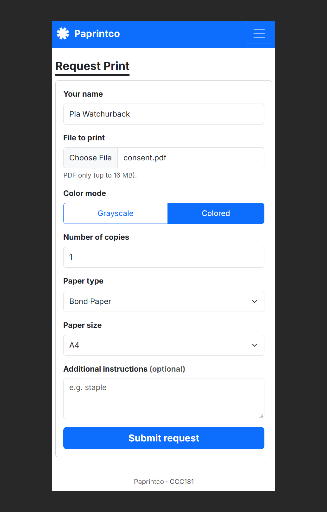
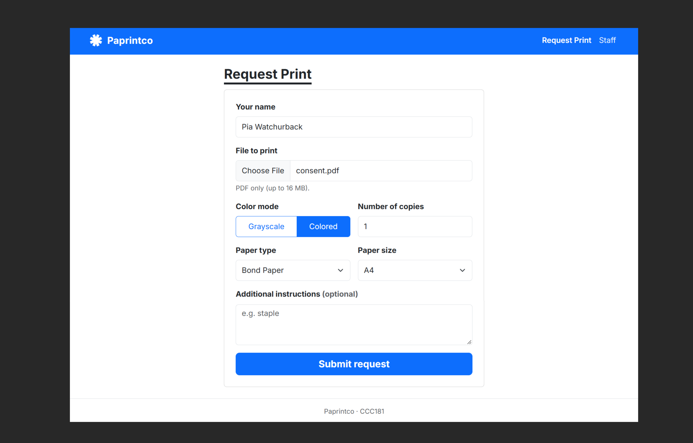
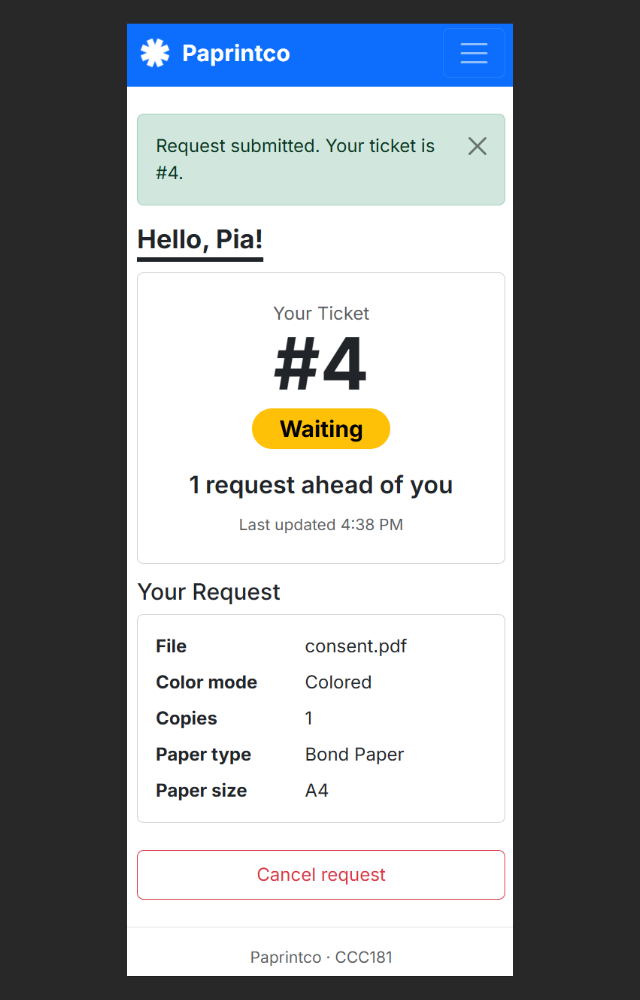
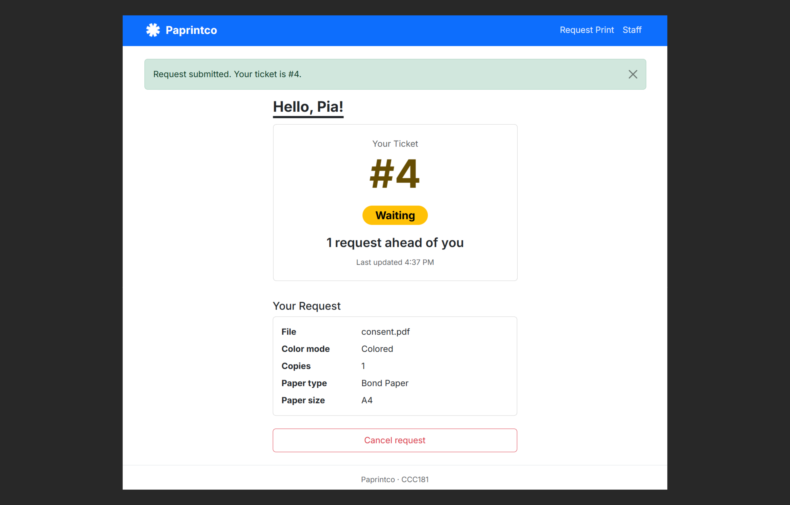
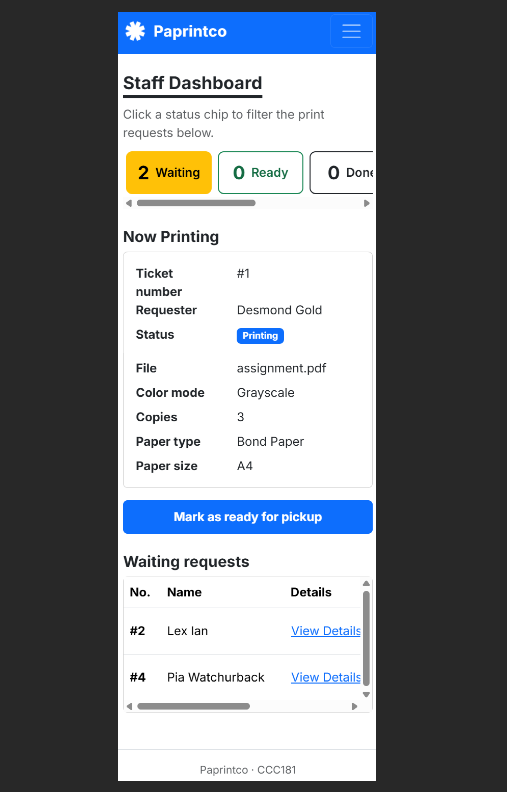
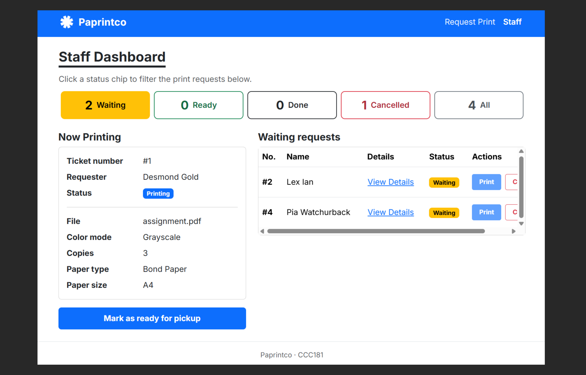
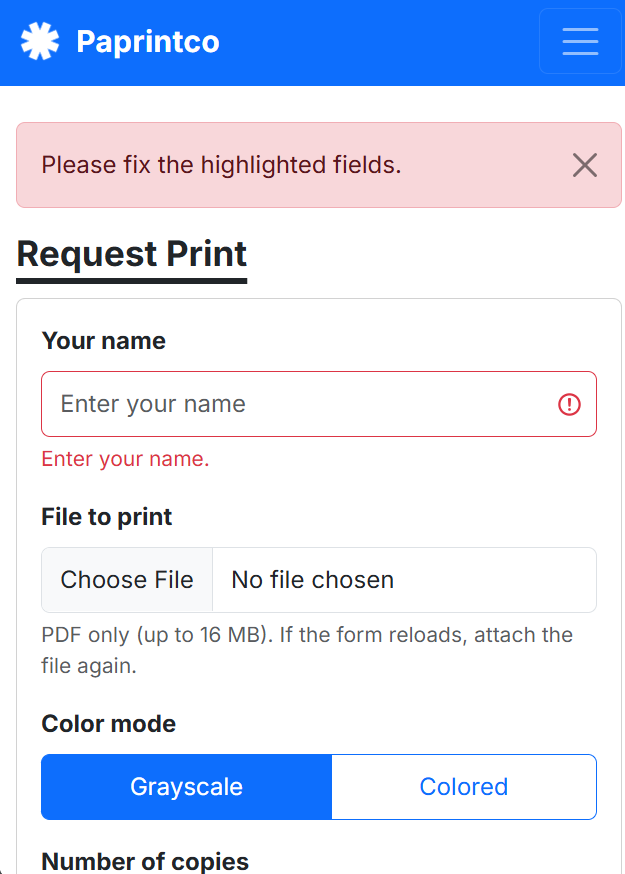
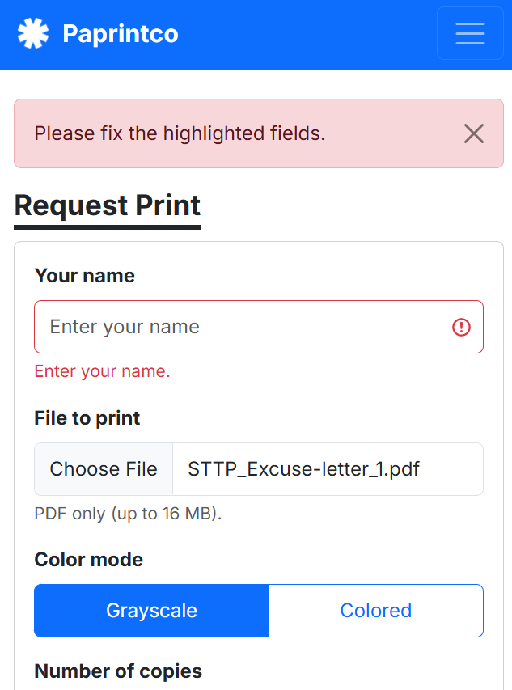

# Report

## 1. Title details

| | |
| --- | --- |
| **App name** | Paprintco |
| **Setting** | A free student-organization printing service with a first come, first served print queue |
| **Full name** | Desmond Gold G. Bongcawel |
| **Student ID** | 2024-0083 |
| **Section** | CS3B |
| **Date** | October 29, 2026 |
| **Pull request** | https://github.com/cooky922/CCC181/pulls |

## 2. Personas

Full personas: [personas.md](personas.md)

**Pia, the person waiting**
- Quote: "Daghan kaayo kog i-print, pero dili pud ko ganahan magtambay ug pila ka minuto sa printing station nga wa ko kabalo kung kanus-a nako ma claim. If possible, gusto nako i-submit akong file and get notified kung ready na i-claim." [I have a lot to print, but I don't want to hang around the printing station for several minutes not knowing when I can claim it. If possible, I want to submit my file and get notified when it is ready to claim.] (interview)
- Top tasks: submit her name, PDF and print settings (FR-01), get a ticket number (FR-02), check how many requests are ahead and the current status (FR-03), see her position and status update automatically (FR-04), and cancel a request that is still waiting (FR-05).

**Renebel, the staff member**
- Quote: "Usahay kapoy na gyud kay sige'g send ug files ang mga tao sa Messenger tibuok adlaw. Mag-scroll pa ko pataas ug paubos para ma-check pa kung kinsay unang nag-send, unya kung naay malaktawan, murag ako dayon ang basulon. Lisod kaayo i-track ang tanan kung daghan na kaayo ang requests." [Sometimes it gets tiring because people keep sending files on Messenger all day. I have to scroll up and down to check who sent first, and if someone gets skipped, I am the one to blame. It is very hard to track everything when there are many requests.] (interview)
- Top tasks: see all waiting requests with their print settings in queue order (FR-06), and print the next request and update its status (FR-07).

## 3. Screens

Join on a phone: used by Pia to send her PDF and print settings from her phone between lab sessions (FR-01).

Join on a laptop: used by Pia when she is writing on her laptop, to submit her request (FR-01).

My place on a phone: used by Pia to get her ticket number, check how many requests are ahead and her status, see them update automatically, and cancel while still waiting (FR-02, FR-03, FR-04, FR-05).

My place on a laptop: used by Pia to get her ticket number, check how many requests are ahead and her status, see them update automatically, and cancel while still waiting (FR-02, FR-03, FR-04, FR-05).

Staff dashboard on a phone: used by Renebel when away from the laptop, to check the queue and change a status (FR-06, FR-07).

Staff dashboard on a laptop: used by Renebel at the printing station to see the queue in order, print the next request and update its status (FR-06, FR-07).

## 4. Design decisions

1. **The ticket number, status and "requests ahead" are the largest things on My place.** Pia checks her phone between lab sessions and has tired eyes late in the day. The waiting status color also uses a darker yellow so that the large ticket number has enough contrast.
2. **The staff dashboard has one "Print next" button that only picks the earliest waiting request, and it is only shown when nothing is printing.** Renebel said in the interview that it is hard to know which request to entertain first and that being blamed for skipping someone is kind of a worry. One printing request at a time also matches my queue rule. The "Now Printing" card shows the file, color, copies and paper type without any click, so there is no need to ask the requester again.
3. **The join form uses plain labels for every choice, shows a text message under each field, and keeps what Pia already entered, including the PDF.** Pia said wrong print settings mean costly reprints, and the usability test showed that losing the file after an error is very frustrating on a phone. The form also has no login or email, so only what a print job needs was provided.

## 5. Self-review

- **Join:** The "[Upload File (.pdf)]" field did not provide enough space to display the selected filename or upload restrictions. Additionally, the wireframe did not illustrate how the form responds to missing required fields or invalid file types. I kept the layout (one column on the phone, two on the laptop). I added a message in text under each field (for instance "Enter your name.") that appears after submitting, and the form keeps what Pia typed. Inputs and buttons are at least 44 px tall.
- **My place:** The "WAITING" badge was very small compared with the ticket number, nothing showed how close the request was to being done, and "Updated just now" overlapped the "Your Request" box on the laptop frame. I kept the order (ticket number, status, position, request details, cancel). The status is now a larger label using the same five words as the staff dashboard (Waiting, Printing, Ready, Done, Cancelled), the overlap is fixed, and Cancel only shows while the request is waiting and asks "Cancel this request?" first. The page refreshes by itself every 10 seconds.
- **Staff dashboard:** "Print next" was drawn as available while a request was already printing, which possibly leads to a mistake, and the phone and laptop frames did not agree on the counts. I kept the two-column laptop layout. "Print next" now only appears when nothing is printing, and the Print button on a waiting row is disabled when the ticket is not next in line. The same five status counts now appear on phone and laptop, as chips that scroll sideways on a phone, and they also work as the filter. Each request's file and print details are available through "View Details".

## 6. Accessibility

Lighthouse accessibility scores

| Screen | Before | After |
| --- | --- | --- |
| Join | 100 | 100 |
| My place | 96 | 100 |
| Staff dashboard | 100 | 100 |

The most important issue I fixed was low color contrast on My place: the large ticket number used `text-warning` (yellow) on white, which has a contrast ratio of only 1.63 while large text needs at least 3. I changed it to Bootstrap's darker `text-warning-emphasis`, and the status is still shown in words on the badge. Full notes: [accessibility.md](accessibility.md)

## 7. Usability test

I tested with Dorti, a co-officer in a student organization, on October 28, 2026, using her own phone. She played both the requester and the staff member, and I ran the tasks in the order 1, 3, 2 so she could see her new ticket on the staff dashboard and then see her staff actions on My place. Full notes: [usability-test.md](usability-test.md)

- **Task 1, get in line for Print (about 3 minutes 17 seconds):** She finished it. Most of the time went into finding a sample PDF on her phone. When the name was left blank, the form returned an error and cleared the PDF she had chosen, so she had to pick the file again.
- **Task 2, how many people are ahead and what is the ticket number (about 27 seconds):** She finished it and found the ticket number, status and "requests ahead" message very quickly. It was the fastest task.
- **Task 3, as staff, print the next request and mark it as ready for pickup (about 1 minute 46 seconds):** She finished it but needed time to work out where to filter and which button to press first. She found "View Details" on her own and could read all the print settings.

**The one improvement:** The PDF was cleared when another field had an error. Now the server saves a valid PDF immediately, even if another field fails, and the form comes back with the error and the PDF still attached. The file box shows the file name again, so it looks the same as before the error. When she fixes the other field and submits again, no new upload is needed, and a new file replaces the old one.

| Before | After |
| --- | --- |
|  |  |

## 8. Reflection

The hardest parts this week were Part 2 (the wireframes) and Part 10 (the usability test). I had not used Figma for a while, so it took me time to get back into it and to work out what the main instructions of that part were asking, and I was frustrated while doing it. Part 10 was frustrating too, because the major problem I had to fix involved something that had not been discussed in class, so I had to look up solutions in other places before I could make the PDF stay attached after an error.

In Week 4, my tickets (requests) will move from a Python traditional list into a proper database. As of right now, the tickets will always get deleted every time the app restarts. With a database, I can keep each ticket's record and status. The ticket number and the "requests ahead" count can then be made by the database instead of from the list.

## 9. Declaration

I used Claude and ChatGPT while working on this week's activity. I used them to help refine my UI and logic components, and to fix bugs and errors in my app. I also used Claude to explain instructions that I did not understand and to help organize and proofread my Markdown documents. I reviewed the suggestions and applied them where appropriate.