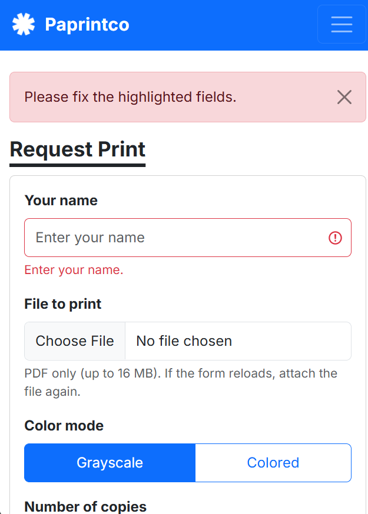
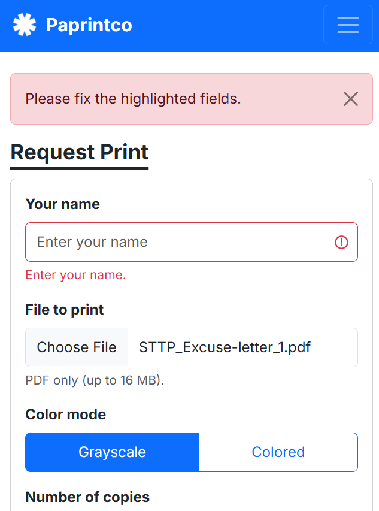

# Usability Test and Improvement

## 10a. Test with a real user

| | |
| --- | --- |
| **Participant** | Dorti (modified her nickname a bit) |
| **Matches persona** | Matches Pia's persona because she is a student who needs copies of a PDF but does not own a printer. She also has experience working at a student-organization printing station, so for the staff task she is close to Renebel's persona. |
| **Setting / relation** | A co-officer (although in a different committee) in a student organization and a 3rd-year engineering student. Not a CCC181 classmate. |
| **Date and method** | October 28, 2026, around 2:00 PM, in person, using observation notes |
| **Device** | Participant's own phone |
| **Permission** | Yes, she agreed to try the app. No audio or video was recorded. |

### Note/Setup:
- My participant played both roles: the student who wants a print, and the staff member.
- I restarted the app before the session so the sample data was reset. The queue started with #1 waiting and #2 printing, so her new request got ticket #3.
- I ran task 1, then task 3, then task 2. After she submitted her request, she moved to the staff dashboard, where she could see her own newly added ticket (#3) in the waiting list and work the queue. In task 2 she went back to My place and could see the changes that her staff actions had made to her ticket.
- No recording was made, so I only wrote down what I observe during the session.

### Results by task

| Task | Did they finish it? (yes / with help / no) | About how long it took | Where they hesitated, what they said, and anything that surprised me |
| --- | --- | --- | --- |
| **1.** "You just arrived. Get in line for Print." (Submit a PDF for 3 copies, Colored, Bond Paper, A4.) | Yes | About 3 minutes 17 seconds | Most of the time went into finding a sample PDF on her phone, not into the form. She also found a major problem: when the name was left blank, the form returned an error and cleared the selected PDF, so she had to choose the file again. This is kind of frustrating when using phones and even on laptops. |
| **2.** "You are waiting now. How many people are ahead of you? What is your ticket number?" | Yes | About 27 seconds | She found the ticket number, the status and the "requests ahead" message very quickly on her phone. It was the fastest task. These three things are the largest text at the top of My place. |
| **3.** "Pretend you are the staff member. Print the next request and mark it as ready for pickup." | Yes | About 1 minute 46 seconds | She needed time to figure out where to filter and which button to press first. #2 was already printing, so the first button shown was "Mark as ready for pickup", and "Print next" only appears after that. The status filter is a row of colored counts at the top, which scrolls sideways on a phone. |

### Which of your persona's "Because …, my interface must …" rules held up, and which did not?

| Rule | Held up? | Test |
| --- | --- | --- |
| **Pia:** Because she checks her phone between lab sessions, my interface must make the ticket number, status and "requests ahead" the biggest things on My place. | Yes | Task 2 took only about 27 seconds on a phone, and she found all three quickly. |
| **Pia:** Because her campus Wi-Fi is slow, my interface must keep pages light and update the status by itself every 10 seconds. | Not tested | The session was not done on slow Wi-Fi, and I did not note whether she saw the automatic update. |
| **Pia:** Because wrong print settings mean wasted reprints, my interface must show every choice with plain labels and clear error messages that keep what she typed. | Partly | She finished the request, so the labels and choices worked. But the error did not keep everything she did: the text fields stayed, but the PDF was already cleared. |
| **Pia:** Because she is often carrying things, my interface must have buttons and inputs large enough to tap with one hand. | Yes | She did all three tasks on her own phone, and no tapping problems were noted. |
| **Renebel:** Because she is unsure which request to entertain first, my interface must list requests oldest first and have one "Print next" button that only picks the first-come ticket. | Partly | She finished task 3, but it took about 1 minute 46 seconds, mostly to work out where to filter and which button to press first. |
| **Renebel:** Because she is serving people at the same time, my interface must show every request's file, color, copies, paper type and notes. | Yes | She found and opened "View Details" on her own and could read the file, color, copies, paper type and notes. For the request that is printing, the "Now Printing" card already shows all of these without any click, so only requests that are not printing yet need the extra tap on "View Details". |
| **Renebel:** Because the counter is busy, my interface must make status changes one click and show them in words, not only color. | Yes | She completed the status changes in task 3, and every status is shown as a word on a badge. |
| **Renebel:** Because many requesters ask "is mine done?", my interface must show status changes on the requester's ticket automatically. | Not tested | I did not note whether she watched the ticket change after the staff actions. |

### Other findings (not fixed this week)

| Finding | Decision |
| --- | --- |
| The paper type options (Bond Paper, Photo Paper, Sticker Paper, Cardstock) and paper size options (Short, A4, Long) were limited. | Kept as they are for now. The lists can be extended later. |
| There is no page number selection, so a requester cannot say which pages to print. | Left out on purpose to keep the application simple for now. It can be implemented later, for example as an optional "pages to print" field on the request form. Until then, the "Additional instructions" box can be used to write the pages. |

## 10b. Make one improvement

**Most serious problem found:** When a requester left the name blank, the form came back with an error and the selected PDF was gone. She had to find and choose the file again which was very frustrating. On a phone and on slow campus Wi-Fi this costs time and patience, and it affects the first thing every requester does.

**My fix:** When the form receives a valid PDF, the server now saves it right away, even if another field fails. The form comes back with the error message with the pending file being saved at the moment. When the requester fixes the other field and submits again, the saved PDF is used, so no new upload is needed. A new file replaces the old one. The file name is checked against a strict pattern, so a made-up name can't point to another file on the server. I changed `join()` in `app.py` and the file field in `templates/join.html`.

| Before | After |
| --- | --- |
|  |  |