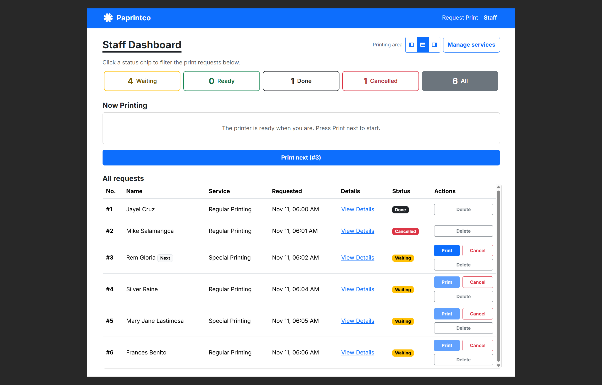
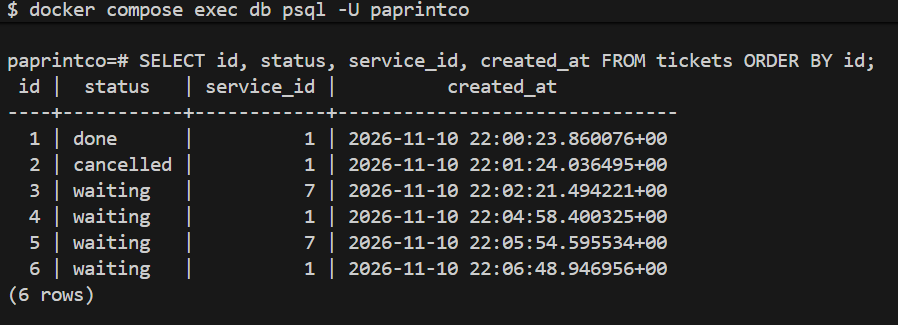
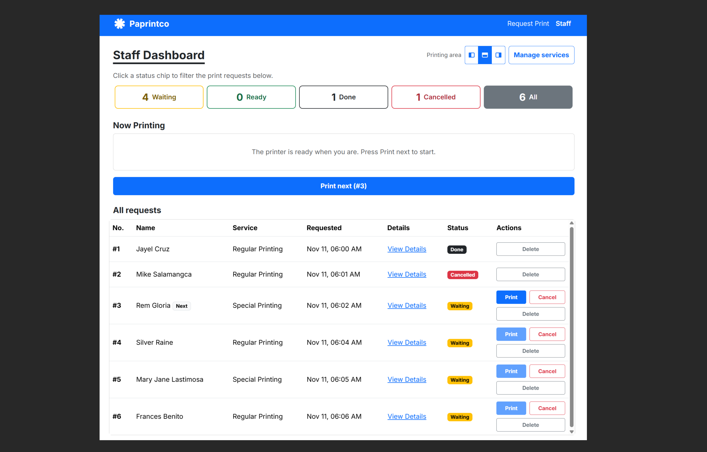
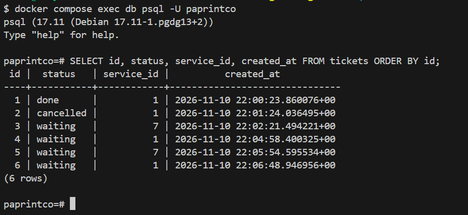

# Persistence

## 11a. The restart test

1. Create at least **five tickets** across at least two services. Call one, serve one, and let one person leave.

2. 📷 The staff dashboard, and the result of `SELECT id, status, service_id, created_at FROM tickets ORDER BY id;` in psql.

3. Stop Flask with Ctrl+C. Run `docker compose down`. Run `docker compose ps` and see that nothing is running.

4. Run `docker compose up -d`, wait until `docker compose ps` says **healthy**, then start Flask again.

5. 📷 The same dashboard and the same SQL query. Every ticket, status and time must be exactly as before.

## 11b. Rebuild from scratch

I deleted the whole database, including its volume, and rebuilt it only from the migrations and the seed command.

1. `docker compose down -v`
2. `docker compose up -d` and waited until `docker compose ps` said healthy
3. `flask --app app db upgrade`
4. `flask --app app seed`
5. `flask --app app run --debug` (to open the app)

### Result
- `\dt` shows `users`, `tickets`, `services` and `alembic_version`, so the migrations rebuilt every table without `db.create_all()`.
- `SELECT * FROM services;` shows one service, **Printing**, created by `seed`. The extra services I made by hand in "Manage services" were not recreated, because the seed command only adds "Printing".
- The app opens, the join form lists **Printing**, and I could join and get a ticket.
- The whole database can be rebuilt from the migrations and the seed on a new computer, so no table or column is missing from them.