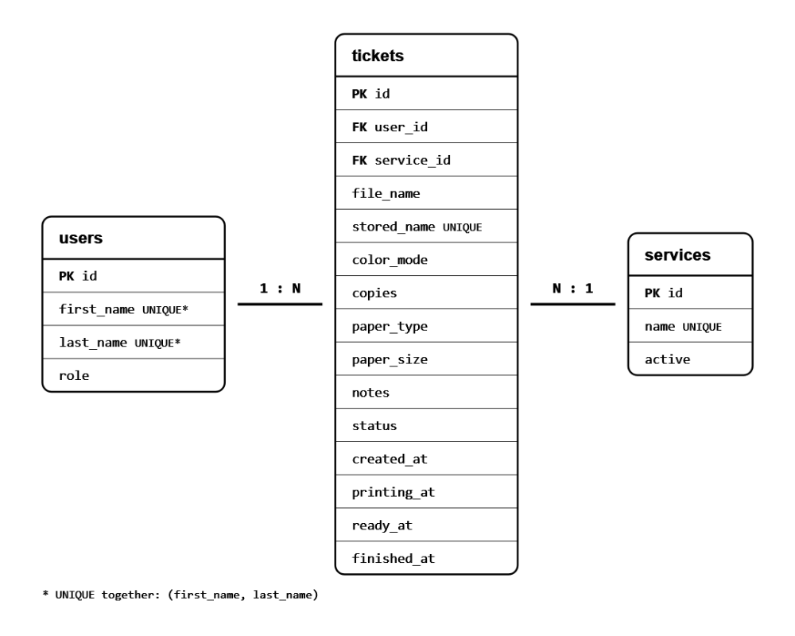
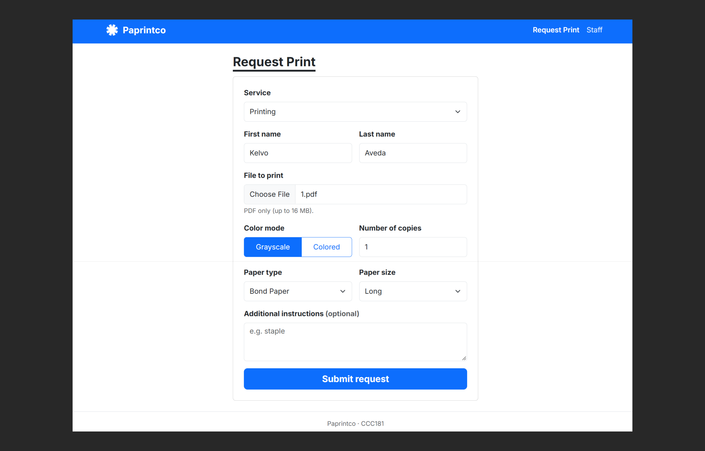
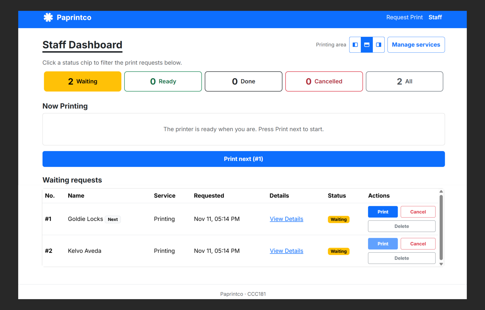
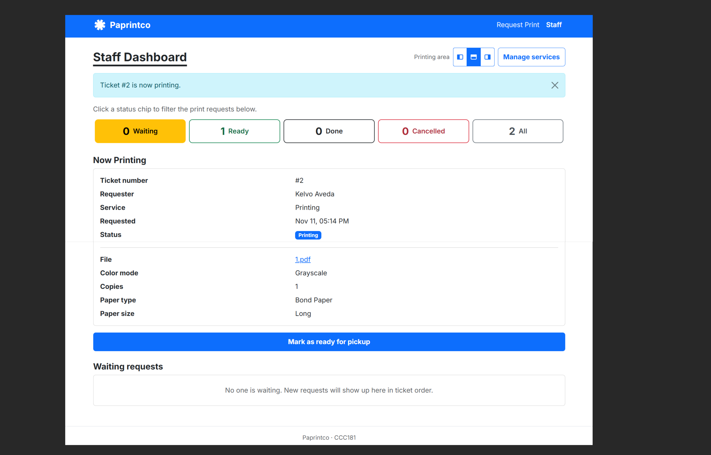
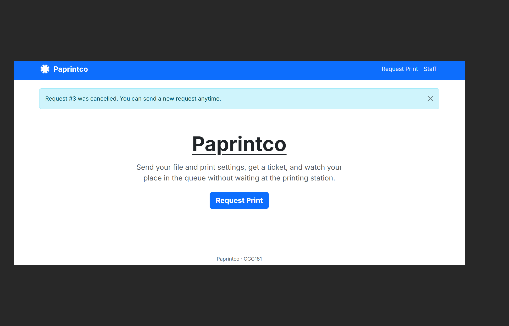
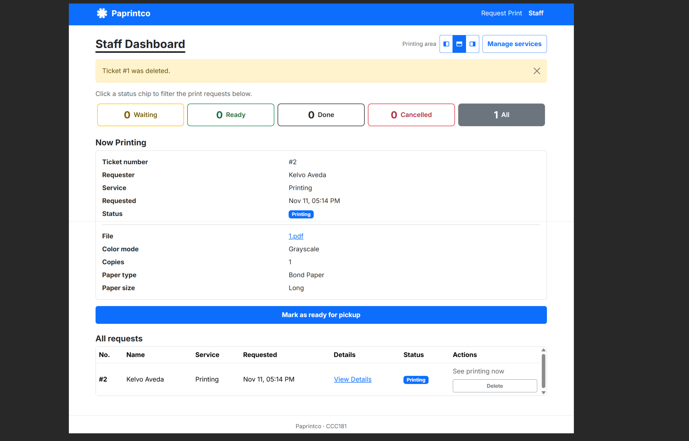
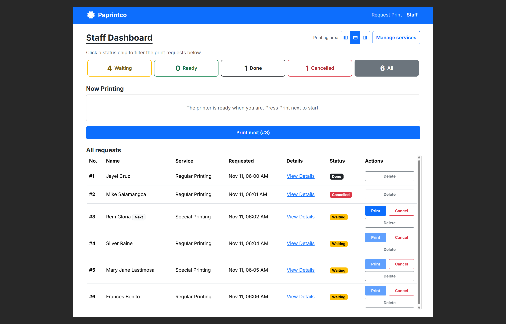
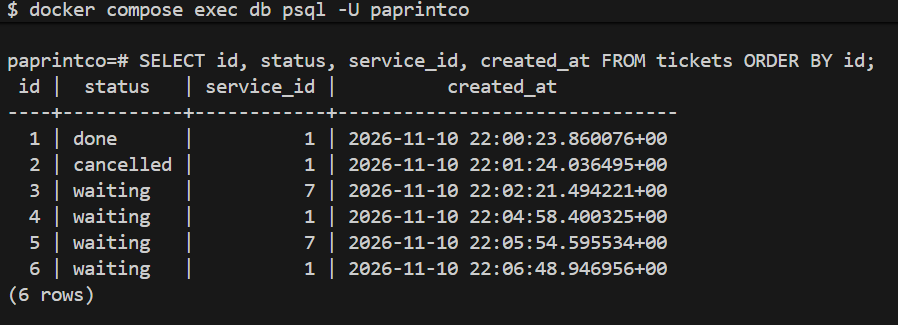
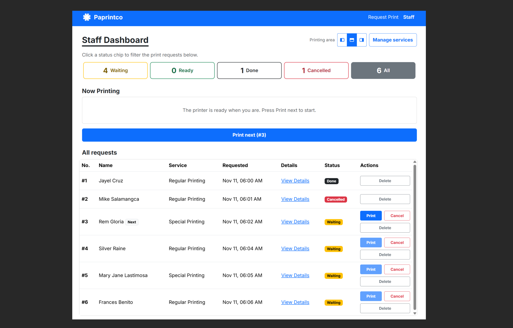
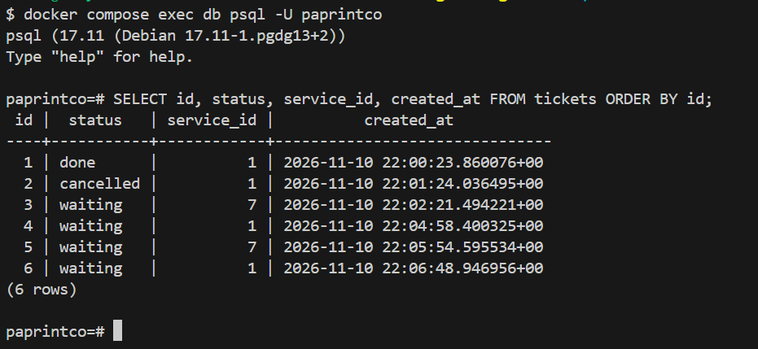

# Report

## 1. Title details

| | |
| --- | --- |
| **App name** | Paprintco |
| **Setting** | A free student-organization printing service with a first come, first served print queue |
| **Full name** | Desmond Gold G. Bongcawel |
| **Student ID** | 2024-0083 |
| **Section** | CS3B |
| **Date** | November 11, 2026 |
| **Pull request** | https://github.com/cooky922/CCC181/pull/NUMBER |

## 2. Requirements

- **Functional requirements:** 21 (FR-01 to FR-21)
- **Non-functional requirements:** 13 (NFR-01 to NFR-13)
- **MVP:** FR-01 to FR-14 and FR-17 (functional), and NFR-03, NFR-04, NFR-05, NFR-10, NFR-11 and NFR-12 (non-functional).
- **Feedback from my setting:** An undergraduate student who requests prints told me she wants to choose which pages to print, wants to see right away when the printer is out of ink or paper, is fine with a limit of 20 pages per week because the printing is free, and needs services other than printing, such as photocopying her COR for a scholarship. I kept FR-15, FR-18 and FR-20 as *Later* because she wanted them, changed FR-19 to name her limit of 20 pages per week, and added FR-21 for other services.

- **Full requirements:** [docs/requirements.md](../requirements.md)

## 3. ERD



1. One user has many tickets. Each ticket belongs to exactly one user through `tickets.user_id`. (1:N)
2. One service has many tickets. Each ticket belongs to exactly one service through `tickets.service_id`. (1:N)

- **Full schema design:** [docs/week4/schema.md](schema.md)

## 4. Schema

```
paprintco=# \d
                List of relations
 Schema |      Name       |   Type   |   Owner   
--------+-----------------+----------+-----------
 public | alembic_version | table    | paprintco
 public | services        | table    | paprintco
 public | services_id_seq | sequence | paprintco
 public | tickets         | table    | paprintco
 public | tickets_id_seq  | sequence | paprintco
 public | users           | table    | paprintco
 public | users_id_seq    | sequence | paprintco
(7 rows)
```

```
paprintco=# \d users
                                     Table "public.users"
   Column   |         Type          | Collation | Nullable |              Default              
------------+-----------------------+-----------+----------+-----------------------------------
 id         | integer               |           | not null | nextval('users_id_seq'::regclass)
 first_name | character varying(60) |           | not null | 
 last_name  | character varying(60) |           | not null | 
 role       | character varying(20) |           | not null | 'requester'::character varying
Indexes:
    "users_pkey" PRIMARY KEY, btree (id)
    "uq_users_first_name_last_name" UNIQUE CONSTRAINT, btree (first_name, last_name)
Check constraints:
    "ck_users_first_name" CHECK (length(TRIM(BOTH FROM first_name)) > 0)
    "ck_users_last_name" CHECK (length(TRIM(BOTH FROM last_name)) > 0)
    "ck_users_role" CHECK (role::text = ANY (ARRAY['requester'::character varying, 'staff'::character varying]::text[]))
Referenced by:
    TABLE "tickets" CONSTRAINT "tickets_user_id_fkey" FOREIGN KEY (user_id) REFERENCES users(id) ON DELETE RESTRICT
```

```
paprintco=# \d services
                                    Table "public.services"
 Column |          Type          | Collation | Nullable |               Default                
--------+------------------------+-----------+----------+--------------------------------------
 id     | integer                |           | not null | nextval('services_id_seq'::regclass)
 name   | character varying(100) |           | not null | 
 active | boolean                |           | not null | true
Indexes:
    "services_pkey" PRIMARY KEY, btree (id)
    "services_name_key" UNIQUE CONSTRAINT, btree (name)
Check constraints:
    "ck_services_name" CHECK (length(TRIM(BOTH FROM name)) > 0)
Referenced by:
    TABLE "tickets" CONSTRAINT "tickets_service_id_fkey" FOREIGN KEY (service_id) REFERENCES services(id) ON DELETE RESTRICT
```

```
paprintco=# \d tickets
                                       Table "public.tickets"
   Column    |           Type           | Collation | Nullable |               Default               
-------------+--------------------------+-----------+----------+-------------------------------------
 id          | integer                  |           | not null | nextval('tickets_id_seq'::regclass)
 user_id     | integer                  |           | not null | 
 service_id  | integer                  |           | not null | 
 file_name   | character varying(255)   |           | not null | 
 stored_name | character varying(36)    |           |          | 
 color_mode  | character varying(10)    |           | not null | 
 copies      | integer                  |           | not null | 1
 paper_type  | character varying(50)    |           | not null | 
 paper_size  | character varying(50)    |           | not null | 
 notes       | text                     |           |          | 
 status      | character varying(20)    |           | not null | 'waiting'::character varying
 created_at  | timestamp with time zone |           | not null | now()
 printing_at | timestamp with time zone |           |          | 
 ready_at    | timestamp with time zone |           |          | 
 finished_at | timestamp with time zone |           |          | 
Indexes:
    "tickets_pkey" PRIMARY KEY, btree (id)
    "tickets_stored_name_key" UNIQUE CONSTRAINT, btree (stored_name)
    "uq_tickets_one_printing" UNIQUE, btree (service_id) WHERE status::text = 'printing'::text
Check constraints:
    "ck_tickets_color_mode" CHECK (color_mode::text = ANY (ARRAY['Grayscale'::character varying, 'Colored'::character varying]::text[]))
    "ck_tickets_copies" CHECK (copies >= 1 AND copies <= 100)
    "ck_tickets_file_name" CHECK (length(TRIM(BOTH FROM file_name)) > 0)
    "ck_tickets_finished_at_after_created" CHECK (finished_at IS NULL OR finished_at >= created_at)
    "ck_tickets_notes" CHECK (notes IS NULL OR length(notes) <= 300)
    "ck_tickets_paper_size" CHECK (paper_size::text = ANY (ARRAY['Short'::character varying, 'A4'::character varying, 'Long'::character varying]::text[]))
    "ck_tickets_paper_type" CHECK (paper_type::text = ANY (ARRAY['Bond Paper'::character varying, 'Photo Paper'::character varying, 'Sticker Paper'::character varying, 'Cardstock'::character varying]::text[]))
    "ck_tickets_printing_at_after_created" CHECK (printing_at IS NULL OR printing_at >= created_at)
    "ck_tickets_ready_at_after_created" CHECK (ready_at IS NULL OR ready_at >= created_at)
    "ck_tickets_status" CHECK (status::text = ANY (ARRAY['waiting'::character varying, 'printing'::character varying, 'ready'::character varying, 'done'::character varying, 'cancelled'::character varying]::text[]))
    "ck_tickets_stored_name" CHECK (stored_name::text ~ '^[0-9a-f]{32}\.pdf$'::text)
Foreign-key constraints:
    "tickets_service_id_fkey" FOREIGN KEY (service_id) REFERENCES services(id) ON DELETE RESTRICT
    "tickets_user_id_fkey" FOREIGN KEY (user_id) REFERENCES users(id) ON DELETE RESTRICT
```

## 5. Design decisions

1. **I do not keep a "position" column.** The number of requests ahead of Pia is counted from `status`, `created_at` and `service_id` every time she opens My place (FR-03, FR-04). She always sees the right number after the page refreshes, and Renebel never has to update other rows when someone joins, cancels or is printed.
2. **I used a partial unique index, `uq_tickets_one_printing`, on `tickets.service_id` where the status is `printing`.** Renebel's rule is one request printing at a time (FR-17). If Flask has a bug, or two staff members click Print at the same moment, PostgreSQL still refuses the second one, and the app shows a message instead of crashing.
3. **I split a person's name into `first_name` and `last_name`, with a `UNIQUE (first_name, last_name)` pair, and Flask fixes the capitalization before saving.** The app has no login or email (FR-01), so the name pair is how it knows Pia again when she sends another request. "goldie gloriaz" and "Goldie Gloriaz" become the same person and get a new ticket under the same `users` row. In this project, I assume that no two people share the same first and last name together given that the users are from MSU-IIT.

## 6. Self-review

The main problems I found in my schema are: 
1. `tickets` had five timestamps but no requirement mentions a time, and `completed_at` and `cancelled_at` were two columns for one fact. I merged them into `finished_at` and kept `printing_at`, `ready_at` and `finished_at` with a check that none is before `created_at`. 

2. One `name` column could save the same person twice with the name typed in a different order, so I split it into `first_name` and `last_name` with a unique pair. 

3. A `text` column for notes has no length limit, so I kept `CHECK (notes IS NULL OR length(notes) <= 300)` as a last line of defense behind Flask. 

4. When staff delete a request (FR-13), the PDF could stay on disk, so the app deletes the PDF first (the duplicated file with auto-generated file name) and then the ticket row. 

Full notes: [schema-review.md](schema-review.md)

## 7. Migrations

1. **36d9700845d7_initial_tables.py** -> This file creates the `users`, `services` and `tickets` tables with their keys, CHECK constraints and the one-printing-per-service index.

2. **b43c2379c44f_add_services_active.py** -> This file adds an `active` true-or-false column to `services` so staff can switch a service off without deleting it. Existing rows get `true`.

## 8. CRUD

### Create
- **Screenshot:** 
- **Route:** POST /join -> join()
- **Requirement ID:** FR-01, FR-02

### Read
- **Screenshot:** 
- **Route:** GET /staff -> staff_dashboard() (and GET /queue/<ticket_id> -> ticket() for My place)
- **Requirement ID:** FR-06 (and FR-03 for My place)

### Update
- **Screenshot:** 
- **Route:** POST /staff/tickets/<ticket_id>/<action> -> staff_action() (Print, Mark as ready, Mark done), and POST /staff/call-next -> staff_call_next()
- **Requirement ID:** FR-07, FR-09, FR-10

### Soft delete
- **Screenshot:** 
- **Route:** POST /queue/<ticket_id>/leave -> leave() (the status becomes `cancelled` and the row stays)
- **Requirement ID:** FR-05

### Hard delete
- **Screenshot:** 
- **Route:** POST /staff/tickets/<ticket_id>/delete -> delete_ticket()
- **Requirement ID:** FR-13

## 9. Validation

I tested 28 rules in [validation.md](validation.md): 9 in Flask and 19 in the database. Flask rejects bad requests with HTTP/1.1 400 BAD REQUEST, and the database is the last line of defense behind Flask with FOREIGN KEY, CHECK, UNIQUE, NOT NULL and RESTRICT. The most useful PostgreSQL error is `ERROR: duplicate key value violates unique constraint "uq_tickets_one_printing"`, because it proves that the database itself keeps my queue rule (FR-17): only one request can be printing for a service.

## 10. Persistence

### Restart test screenshots

**Before restart screenshots:**




**After restart screenshots:**




After `docker compose down` and `docker compose up -d`, the dashboard and the `SELECT id, status, service_id, created_at FROM tickets ORDER BY id;` result were exactly the same as before. I also deleted the database volume with `docker compose down -v` and rebuilt it with `flask --app app db upgrade` and `flask --app app seed`. Both migrations ran with no errors, all tables were created again, the seed added the starting service, **Printing**, and I could join and get a ticket. NFR-03 (no ticket, user or service is lost on a restart) passed. 

- Full steps: [persistence.md](persistence.md)

## 11. Reflection

The hardest part for me this week was the validation part (Part 10). The `tickets` table has many fields (service, color mode, copies, paper type, paper size, notes, file name, stored file name, status and four timestamps), and each one has its own rule that has to hold in two places: in Flask and in the database. I struggled to remember which rules existed and which ones I had already tested, so I had to list every constraint from `\d tickets` first and then test them one at a time, changing only one field per request, so I could tell which field caused each error. The hardest requirement to write in a testable way was FR-12 (a requester's PDF is deleted from the server when their request is done or cancelled). Its result is a file on disk, not a row, so I could not check it with SQL. I had to look inside the `uploads/` folder before and after, and repeat the check for every way a request can end: staff mark it done, staff cancel it, the requester cancels it, and staff delete it permanently. For future reports, my staff persona (Renebel) would want queries built from the data I now save. He would want the average time from when a request joined to when it started printing, per day and per hour of the day, so he can see when people wait the longest. He would want the average print time (from `printing_at` to `ready_at`), so that he can tell how long a job really takes and whether big jobs slow the queue. He would also want the total copies per paper type and size each week, so he knows when to restock paper. And he would also want how many requests are colored and how many are grayscale, so he can plan for the ink that colored printing uses.

## 12. Declaration

I used Claude while working on this week's activity. I used it to explain the instructions that I did not understand, to help write and fix templates, and to help organize and proofread my Markdown documents. I reviewed the suggestions, ran the tests myself and applied them where appropriate.