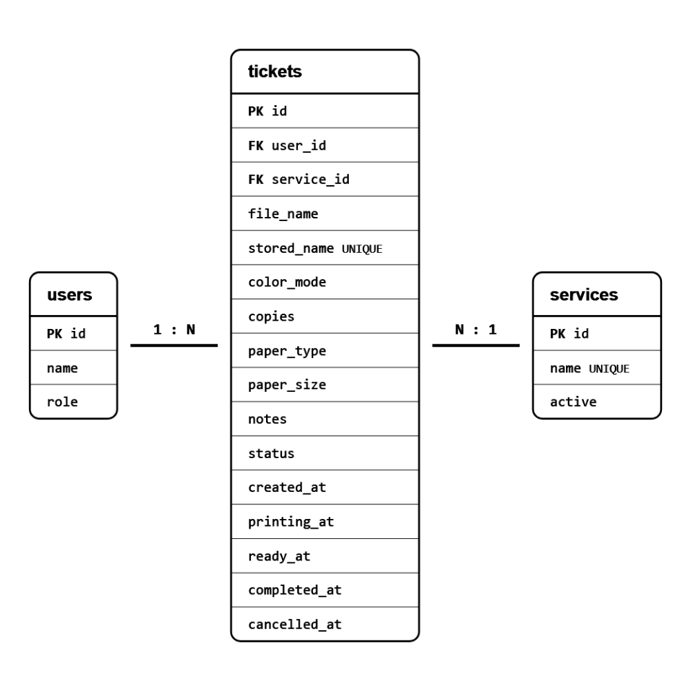

# Paprintco Schema Design
 
## 2a. Find the nouns in your requirements
 
| ID | Requirement | Nouns | Table or column? |
| --- | --- | --- | --- |
| FR-01 | A requester can submit their **name**, one **PDF file** and its **print specifications** (**color mode**, **copies**, **paper type**, **paper size** and **instructions**). | requester, name, PDF file, print specifications, color mode, copies, paper type, paper size, instructions | `users`, `users.name`, `tickets.file_name`, `tickets.stored_name`, `tickets.color_mode`, `tickets.copies`, `tickets.paper_type`, `tickets.paper_size`, `tickets.notes` |
| FR-02 | A requester can receive a **ticket number** after submitting their print request. | requester, ticket number, print request | `tickets.id` |
| FR-03 | A requester can see how many **requests** are **ahead** of theirs and the current **status** of their print request. | requester, requests, ahead, status | `tickets.status`, `tickets.created_at`. The number ahead is computed (not stored) from older waiting requests for the same service |
| FR-05 | A requester can **cancel** their request while it is still **waiting**. | requester, request, cancel, waiting | `tickets.status`, `tickets.cancelled_at` |
| FR-06 | A staff member can see all **waiting requests** in **queue order**, with each request's **print specifications**. | staff member, waiting requests, queue order, print specifications | (no staff login yet), `tickets.status`, `tickets.created_at`, and the print-specification columns in `tickets` |
| FR-07 | A staff member can **print** the next request in the queue. | staff member, request, queue | `tickets.status`, `tickets.printing_at` |
| FR-09 | A staff member can mark the request that is printing as **ready**. | staff member, request, ready | `tickets.status`, `tickets.ready_at` |
| FR-10 | A staff member can mark a **ready** request as **done** when it is picked up. | staff member, request, ready, done, pickup | `tickets.status`, `tickets.completed_at` |
| FR-11 ★ | A staff member can open a request's **PDF** to check it before printing. | staff member, request, PDF | `tickets.stored_name`, `tickets.file_name` |
| FR-12 ★ | A requester's **PDF** is deleted from the server when their request is **done** or **cancelled**. | requester, PDF, request, done, cancelled | `tickets.stored_name` becomes `NULL` after the file is removed from disk. The ticket record remains |
| FR-13 | A staff member can permanently **delete** a request. | staff member, request, delete | The row in `tickets` is deleted (hard delete). The application removes any remaining PDF file first |
| FR-14 | A staff member can add, rename, **deactivate** and delete **services**. | staff member, services, name, active state | `services.id`, `services.name`, `services.active` |
| FR-15 ★ | A requester can choose which **pages** of the PDF to print, or print all pages. *(Later)* | requester, pages, PDF | Not in this schema. It would be `tickets.page_range` in a later task |
| FR-16 ★ | A requester can choose different print specifications for each **page**. *(Won't this semester)* | requester, print specifications, page | Not in this schema. It would be a future `ticket_page_specs` table related to `tickets` |
| FR-17 ★ | A staff member can print only **one request** at a time on each **printer**. | staff member, request, printer | A partial UNIQUE index on `tickets.service_id` where `status = 'printing'`. There is one printer for one service, so one printing ticket per service is the same as one per printer |
| FR-18 ★ | A staff member can mark printing as **unavailable** with a **reason**, and a requester sees the notice and cannot submit until printing is available again. *(Later)* | staff member, printing, reason, requester | Not in this schema. It would use `services.active` and a new reason column |
| FR-19 ★ | A requester can print up to **20 pages per week**, and further requests are refused once that limit is reached. *(Later)* | requester, pages, week, requests | Not in this schema. It needs page counts on `tickets` and a reliable way to identify the requester |
| FR-20 ★ | A staff member can place a request in the **short-document queue** or the **long-document queue** when there are two **printers**. *(Later)* | staff member, request, queues, printers | Not in this schema. It would need a `printers` table and a printer reference on `tickets` |
| FR-21 | A requester can request other **services** besides printing, such as **photocopying** or **blank paper**. *(Later)* | requester, services, photocopying, blank paper | `services` can hold more rows. Service-specific request details can be added when those services are built (status Later) |
 
## 2b. List your tables and columns
 
The schema has three related tables. `users` stores the people who submit requests; `services` stores the available services; and `tickets` stores each submitted print request.
 
| Table | Paprintco columns |
| --- | --- |
| `users` | `id`, `name`, `role` |
| `services` | `id`, `name`, `active` |
| `tickets` | `id`, `user_id`, `service_id`, `file_name`, `stored_name`, `color_mode`, `copies`, `paper_type`, `paper_size`, `notes`, `status`, `created_at`, `printing_at`, `ready_at`, `completed_at`, `cancelled_at` |
 
## 2c. Choose types and constraints on purpose
 
| Table | Column | PostgreSQL type | Constraint | Why |
| --- | --- | --- | --- | --- |
| `users` | `id` | `integer`, generated | `PRIMARY KEY` | Generated by the database and never reused |
| `users` | `name` | `varchar(60)` | `NOT NULL`, `CHECK (length(trim(name)) > 0)` | A person must have a non-empty name, and a name of only spaces is rejected. The limit matches the form |
| `users` | `role` | `varchar(20)` | `NOT NULL`, `DEFAULT 'requester'`, `CHECK (role IN ('requester', 'staff'))` | Limits the role to the two kinds of person in the personas |
| `services` | `id` | `integer`, generated | `PRIMARY KEY` | Generated by the database |
| `services` | `name` | `varchar(100)` | `NOT NULL`, `UNIQUE`, `CHECK (length(trim(name)) > 0)` | Each service has a non-empty name, and no service appears twice |
| `services` | `active` | `boolean` | `NOT NULL`, `DEFAULT true` | Lets staff switch a service off without deleting its history. This column will be added soon (Part 9) |
| `tickets` | `id` | `integer`, generated | `PRIMARY KEY` | This is the ticket number. It stays unique even when two requests are submitted at the same moment |
| `tickets` | `user_id` | `integer` | `NOT NULL`, `FOREIGN KEY REFERENCES users(id) ON DELETE RESTRICT` | Every ticket belongs to an existing user, and a user with tickets cannot be deleted by accident |
| `tickets` | `service_id` | `integer` | `NOT NULL`, `FOREIGN KEY REFERENCES services(id) ON DELETE RESTRICT` | Every ticket refers to an existing service, and a service with tickets cannot be deleted |
| `tickets` | `file_name` | `varchar(255)` | `NOT NULL`, `CHECK (length(trim(file_name)) > 0)` | Keeps the name the requester gave, so staff can recognize the document after the PDF is removed |
| `tickets` | `stored_name` | `varchar(36)` | `UNIQUE`, `CHECK (stored_name ~ '^[0-9a-f]{32}\.pdf$')` | The random name of the PDF on the server, not a path. It is `NULL` once the file is deleted. The pattern stops a made-up name from pointing at another file |
| `tickets` | `color_mode` | `varchar(10)` | `NOT NULL`, `CHECK (color_mode IN ('Grayscale', 'Colored'))` | Allows only the two choices on the form |
| `tickets` | `copies` | `integer` | `NOT NULL`, `DEFAULT 1`, `CHECK (copies BETWEEN 1 AND 100)` | Rejects zero, negative and above-limit copy counts. The form accepts 1 to 100 |
| `tickets` | `paper_type` | `varchar(50)` | `NOT NULL`, `CHECK (paper_type IN ('Bond Paper', 'Photo Paper', 'Sticker Paper', 'Cardstock'))` | One spelling for each paper type. A new type will be added by a new migration |
| `tickets` | `paper_size` | `varchar(50)` | `NOT NULL`, `CHECK (paper_size IN ('Short', 'A4', 'Long'))` | One spelling for each paper size. A new size will be added by a new migration |
| `tickets` | `notes` | `text` | `NULL` allowed, `CHECK (notes IS NULL OR length(notes) <= 300)` | The optional additional instructions, with the same 300-character limit as the form |
| `tickets` | `status` | `varchar(20)` | `NOT NULL`, `DEFAULT 'waiting'`, `CHECK (status IN ('waiting', 'printing', 'ready', 'done', 'cancelled'))` | Only these five statuses used by the application are allowed |
| `tickets` | `created_at` | `timestamptz` | `NOT NULL`, `DEFAULT now()` | Set by the database when the request joins the queue. The queue order comes from this column |
| `tickets` | `printing_at` | `timestamptz` | `NULL` allowed, `CHECK (printing_at IS NULL OR printing_at >= created_at)` | Empty until staff start printing, and never before the ticket was created |
| `tickets` | `ready_at` | `timestamptz` | `NULL` allowed, `CHECK (ready_at IS NULL OR ready_at >= created_at)` | Empty until the request is marked ready for pickup |
| `tickets` | `completed_at` | `timestamptz` | `NULL` allowed, `CHECK (completed_at IS NULL OR completed_at >= created_at)` | Empty until the printout is picked up |
| `tickets` | `cancelled_at` | `timestamptz` | `NULL` allowed, `CHECK (cancelled_at IS NULL OR cancelled_at >= created_at)` | Empty unless a waiting request was cancelled |

**Note:**
- **Staff.** There is no staff login yet, so no staff `users` rows are created.
- **Ticket number.** It is `tickets.id`, so the database makes sure no two tickets share a number.
- **Position in line.** It is not stored. It is the number of waiting tickets of the same service with an earlier `created_at`.
- **Deleting the PDF.** When a request is done or cancelled, the file can be deleted from the server and `stored_name` becomes `NULL` but the `file_name` remains unchanged so the ticket stays as history.
- **One printer.** Only one request can be printing at a time for each printer (one service). If Paprintco later supports more printers, the one-printing index changes to use a printer reference (FR-20).
```sql
CREATE UNIQUE INDEX uq_tickets_one_printing
ON tickets (service_id)
WHERE status = 'printing';
```

## 2d. Draw the ERD
 

 
1. **One user has many tickets.** Each ticket belongs to exactly one user through `tickets.user_id`. (1:N)
2. **One service has many tickets.** Each ticket belongs to exactly one service through `tickets.service_id`. (1:N)

**What happens when a parent row is deleted?** 
1. `tickets.user_id` > `users.id` is **RESTRICTED**, because the tickets are the history of who asked for what, so a user with tickets cannot be deleted.
2. `tickets.service_id` > `services.id` is **RESTRICTED**, because old tickets must keep the service they were submitted for, so a service with tickets cannot be deleted. Staff switch it off with `active` instead. A service with no tickets can be deleted.
 
## 2e. Check that it is normalized

1. **One value per cell (1NF):** No. No column holds a list. A ticket has one color mode, one number of copies, one status and one time for each event, and the additional instructions are one piece of text.
2. **Depends on the whole key (2NF):** Not applicable, because there is no join table. Every table has a single-column primary key, so each column depends on the whole key.
3. **No hidden copies (3NF):** No. I would never have to update the same fact in more than one row. A service's name and active state are stored once, in `services`. A user's name and role are stored once, in `users`. A ticket stores only `user_id` and `service_id`, not copies of them. Print specifications belong in `tickets` because they describe that one request. The position in line and the number of requests ahead are computed from `status`, `created_at` and `id`, so they are never stored and never out of date.